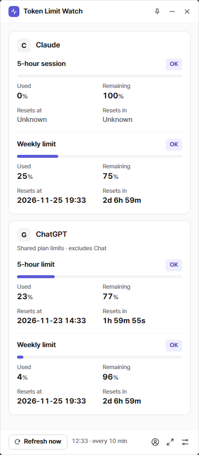
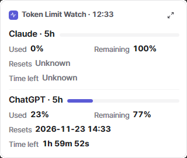
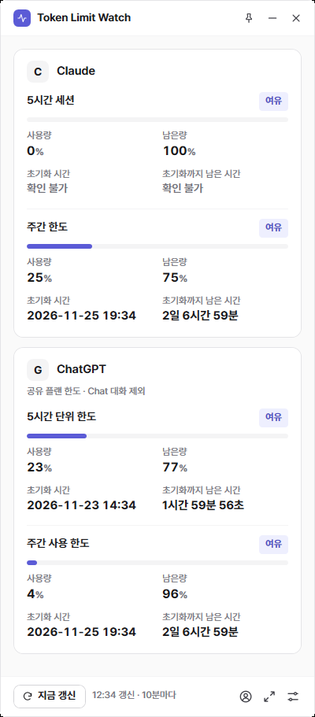
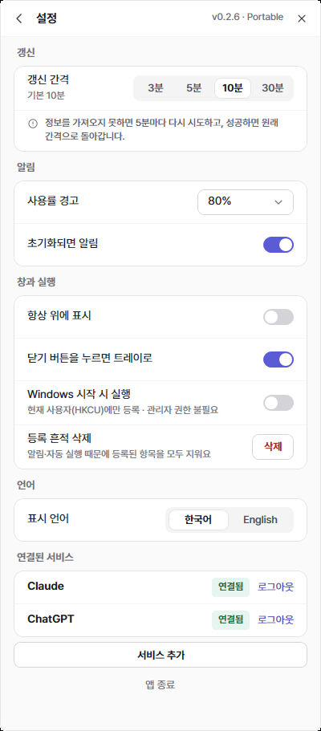

# Token Limit Watch

**A small Windows widget that shows how much of your Claude and ChatGPT plan limits you have left, and when they reset.**

[English](#english) · [한국어](#한국어)

<p>
  
  
</p>

---

## English

Token Limit Watch signs in to your AI subscriptions the same way your browser does, then checks your usage limits on a schedule. It shows the percentage used, the percentage remaining, the exact reset time, and a live countdown to the reset.

### Features

- **Claude**: 5-hour session and weekly limits (plus Opus/Sonnet weekly limits when your plan has them).
- **ChatGPT**: the plan's shared 5-hour and weekly limits (Codex and other agent usage; regular Chat is not counted).
- **Dashboard**: one card per service with used %, remaining %, reset time and countdown. It sizes itself so every card fits without scrolling.
- **Mini widget**: a compact always-on-top window showing both 5-hour limits.
- **Alerts**: a Windows notification when usage passes your threshold (70–95%) and when a limit resets.
- **Refresh**: every 3, 5, 10 or 30 minutes (default 10). Failed checks retry every 5 minutes.
- **Tray**: closing the window keeps it running in the system tray. It can also start with Windows.
- **Language**: Korean or English, switchable in Settings.

### Requirements

- Windows 10 or 11 (x64)
- [Microsoft Edge WebView2 Runtime](https://developer.microsoft.com/microsoft-edge/webview2/) (already installed on Windows 11)

The .NET runtime is bundled, so nothing else needs to be installed.

### Getting started

1. Download `TokenLimitWatch-vX.Y.Z.zip` from [Releases](../../releases) and unzip it into a folder you can write to.
2. Run `TokenLimitWatch.exe`. The build is not code-signed yet, so Windows SmartScreen may ask you to confirm (**More info → Run anyway**).
3. Pick the services to monitor, then sign in to each one with your **email address**. Google sign-in is not supported.
4. The dashboard opens and starts checking. To change the language, go to **Settings → Language**.

Keep `poc-config.json` next to the exe; the app reads service addresses from it.

### Privacy and how it works

- Your password is never stored. The sign-in window is an embedded Edge (WebView2) browser, and the session it creates stays in the `data` folder next to the exe, protected by WebView2's own encryption.
- The app talks only to `claude.ai` and `chatgpt.com`. It sends no telemetry and has no server of its own.
- It reads the same pages and endpoints the websites use for their own usage screens. These are **not official APIs**, so a website change can break a service until the app is updated.
- Do not share the `data` folder: it contains your signed-in sessions.
- Settings → **Remove registry entries** deletes everything the app added to the registry (only the HKCU autostart entry).

### Build from source

Requires the .NET 8 SDK.

```powershell
dotnet run --project src/TokenLimitWatch                 # run
dotnet run --project src/TokenLimitWatch -- --preview    # sample data, no network
dotnet run --project src/TokenLimitWatch -- --preview --en
dotnet run --project tests/TokenLimitWatch.Checks        # checks
dotnet publish src/TokenLimitWatch -c Release -r win-x64 --self-contained true `
  -p:PublishSingleFile=true -p:IncludeNativeLibrariesForSelfExtract=true -o dist/TokenLimitWatch
```

| Folder | Contents |
| --- | --- |
| `src/TokenLimitWatch` | The app (WPF, .NET 8, WebView2) |
| `poc/TokenLimitWatch.Poc` | Proof-of-concept tool that compares ways of reading usage; shares the browser and sign-in code |
| `tests/TokenLimitWatch.Checks` | Console checks for parsing, countdowns, polling and translations |
| `tools/Make-Icon.ps1` | Regenerates the app icon |

### Disclaimer

Token Limit Watch is an independent project. It is not affiliated with, endorsed by, or sponsored by Anthropic or OpenAI. Claude and ChatGPT are trademarks of their respective owners. Use it in line with each service's terms.

### License

[MIT](LICENSE). The bundled Pretendard font is under the SIL Open Font License 1.1 (`src/TokenLimitWatch/Assets/Fonts/Pretendard-LICENSE.txt`).

---

## 한국어

<p>
  
  
</p>

Token Limit Watch는 Claude와 ChatGPT 구독의 **사용 한도가 얼마나 남았는지, 언제 초기화되는지** 보여 주는 Windows 위젯입니다. 브라우저처럼 각 서비스에 로그인한 뒤 정해진 간격으로 사용량을 확인하고, 사용률·남은량·초기화 시각·초기화까지 남은 시간을 표시합니다.

### 주요 기능

- **Claude**: 5시간 세션 한도와 주간 한도. 요금제에 Opus·Sonnet 주간 한도가 있으면 함께 표시합니다.
- **ChatGPT**: 플랜 사용 한도의 5시간 단위 한도와 주간 사용 한도. Codex 등 에이전트 사용량이며 일반 Chat 대화는 제외됩니다.
- **대시보드**: 서비스별 카드에 사용량, 남은량, 초기화 시간, 남은 시간을 보여 줍니다. 시작할 때 모든 카드가 스크롤 없이 보이도록 창 높이를 맞춥니다.
- **미니 위젯**: 두 서비스의 5시간 한도만 보여 주는 작은 창이며 항상 위에 뜹니다.
- **알림**: 사용률이 설정한 기준(70~95%)을 넘거나 한도가 초기화되면 Windows 알림을 띄웁니다.
- **갱신**: 3/5/10/30분 중 선택(기본 10분). 실패하면 5분마다 다시 시도합니다.
- **트레이 상주와 자동 실행**: 창을 닫아도 트레이에서 계속 동작하고, Windows 시작 시 실행할 수 있습니다.
- **언어**: 설정에서 한국어와 English 중 고를 수 있습니다. 처음 실행할 때는 Windows 표시 언어를 따릅니다.

### 설치와 실행

1. [Releases](../../releases)에서 `TokenLimitWatch-vX.Y.Z.zip`을 받아 쓰기 가능한 폴더에 풉니다.
2. `TokenLimitWatch.exe`를 실행합니다. 아직 코드 서명 전이라 SmartScreen 경고가 나오면 **추가 정보 → 실행**을 누르세요.
3. 모니터링할 서비스를 고르고 각 서비스에 **이메일 주소로** 로그인합니다. Google 계정 로그인은 지원하지 않습니다.
4. 대시보드가 열리고 조회를 시작합니다.

필요 조건은 Windows 10/11(x64)과 Microsoft Edge WebView2 런타임입니다(Windows 11에는 기본 설치). .NET은 실행 파일에 포함되어 있습니다. `poc-config.json`은 exe와 같은 폴더에 두세요.

### 개인정보와 동작 방식

- 비밀번호는 저장하지 않습니다. 로그인 창은 앱에 내장된 Edge(WebView2) 브라우저이고, 로그인 세션은 exe 옆 `data` 폴더에 WebView2의 암호화로 저장됩니다.
- `claude.ai`와 `chatgpt.com`에만 접속합니다. 사용 통계를 보내지 않고 별도 서버도 없습니다.
- 각 웹사이트가 자체 사용량 화면에 쓰는 페이지와 주소를 읽습니다. **공식 API가 아니므로** 사이트가 바뀌면 앱을 업데이트하기 전까지 해당 서비스 조회가 실패할 수 있습니다.
- 초기화 시각을 알 수 없는 항목은 추정하지 않고 `확인 불가`로 표시합니다.
- `data` 폴더에는 로그인 세션이 있으니 공유하지 마세요.
- 설정의 **등록 흔적 삭제**는 앱이 레지스트리에 추가한 항목(HKCU 자동 실행 하나)을 모두 지웁니다.

### 소스에서 빌드

.NET 8 SDK가 필요합니다. 명령은 [Build from source](#build-from-source)와 같습니다. `--preview`를 붙이면 네트워크 조회 없이 예시 데이터로 화면을 확인할 수 있고, `--preview --en`은 영문 화면을 보여 줍니다. 예시 값은 실제 사용량이 아니며 설정에 저장되지 않습니다.

### 알림

이 프로젝트는 Anthropic이나 OpenAI와 관계가 없으며 승인이나 후원을 받지 않았습니다. Claude와 ChatGPT는 각 소유자의 상표입니다. 각 서비스의 이용 약관에 맞게 사용하세요.

### 라이선스

[MIT 라이선스](LICENSE)로 공개합니다. 포함된 Pretendard 글꼴은 SIL Open Font License 1.1을 따릅니다.

### 변경 이력

| 버전 | 내용 |
| --- | --- |
| 0.2.6 | 설정에서 한국어·English 선택, README 영문 소개 |
| 0.2.5 | 앱 이름을 Token Limit Watch로 변경, 이전 자동 실행 항목 이전 |
| 0.2.4 | 시작할 때 대시보드가 스크롤 없이 보이도록 창 높이 자동 조정 |
| 0.2.3 | 글꼴을 Pretendard로 통일, 숫자 고정폭 표시 |
| 0.2.2 | 디자인 시안에 맞춘 화면, 미니 위젯 크기 자동 조정 |
| 0.2.1 | 미니 위젯에 5시간 한도만 표시 |
| 0.2.0 | 인디고 디자인 적용, ChatGPT 플랜 사용 한도 조회 |
